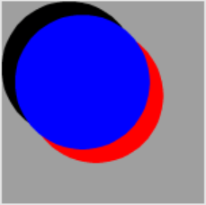
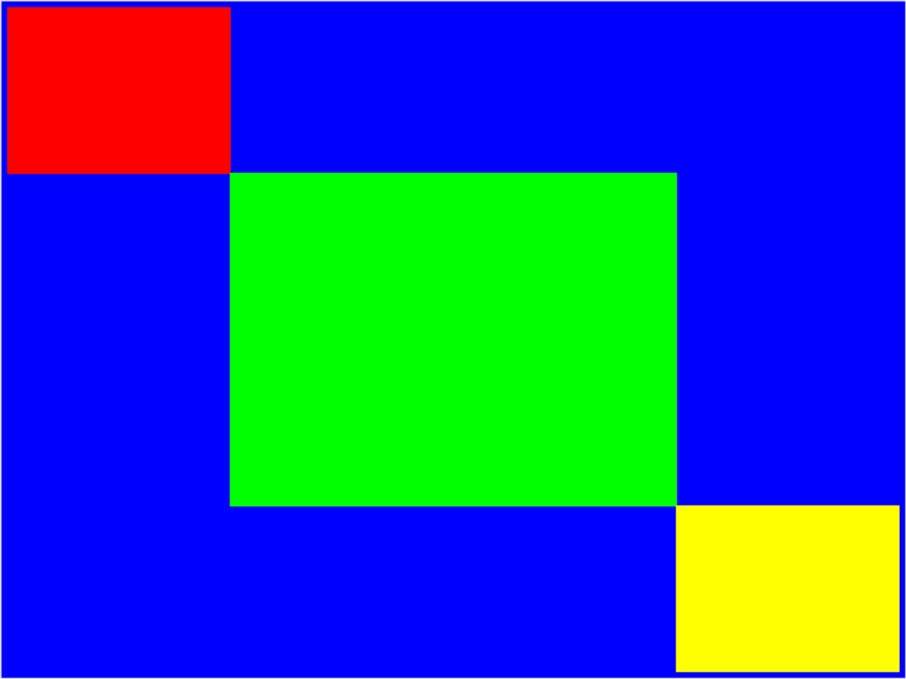
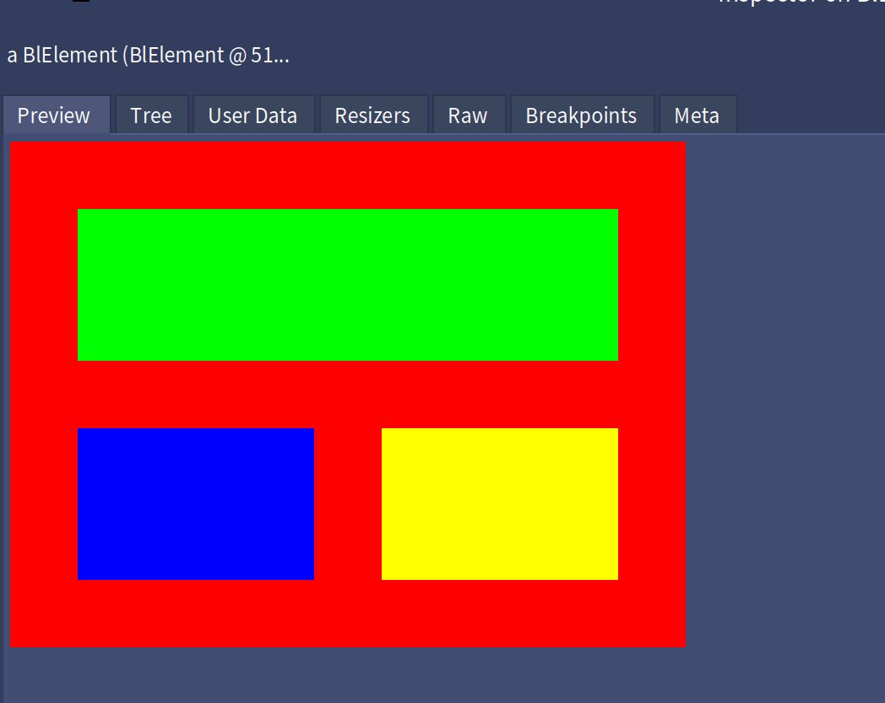

## Layouts in Bloc

### Introduction

Widgets aren't just simple components; they're complex assemblies of various
elements. To create more intricate Bloc elements, you'll need to blend them
together seamlessly. Each element can be developed and examined independently,
which is advantageous during the development phase.  However, to construct a
complete graphical interface, you'll need to seamlessly integrate these elements
with each other or, at the very least, place them within a Bloc *space*.

Element in a Bloc scene are added to each other, ending in a tree-like structure
where parents and children can identify each other, and each element is an
instance of `BlElement`, the root element of Bloc. Each element has its own
visual properties, like background, border, geometry, etc. The final appearance
depends on the graphical properties of each element and how they're arranged
together in the layout.


### Parent children

Elements can be added in the element tree of an element with the `addChild:` method. You can add multiple elements at once 
with `addChildren:`. You can of course remove sub-element with `removeChild:` and `removeChildren:` methods.
Children cannot be rendered outside of the geometry of their parent, unless you set `clipChildren: false` for a parent element.


Browse `BlElement` to find all the available methods
to manage the addition and removal of the elements composing your element.


Layouts constitute a fundamental aspect of *Bloc*. Rather than constructing your
entire widget within a single *drawing* method, it advocates for the creation of
small elements with distinct geometries and visual attributes, which are then
integrated using diverse layout strategies. The layout property determines the
visual arrangement of the element and its descendants, specifying their
positions and sizes within the parent container. Moreover, it may influence the
dimensions of the parent element itself.

When defining layout, two parts must be combined to play together: *parent* and *children* elements.

- Parents define which layout strategy to apply to their children.
- Children specify which constraints they will follow, which could impact their position and size.

Layouts are defined by their *type* and their *constraints*. Types are usually
defined at the parent level with the `layout` method, while you can specify
constraints to your child element using the `constraintsDo:` message, which
supports a set of attributes that define the visual properties of the layout. A
small set of constraints, like padding, margin or minimal and maximum
dimensions, are common among all the layouts. Constraints allow you to clearly
define the size and the position of your element within its parent.

When you change the position or the size of an element, a `requestLayout` is sent
but the effect on the element’s bounds is actually visible only after the layout
is computed. In Bloc, the layout is computed from a dedicated space Phase,
applied on each pulse. Have a look at `BlSpaceFrame` and `BlSpaceFramePhase` and its
subclasses.

To ease this kind of script one can use `whenLayoutedDoOnce:` which arms a one
shot event handler that reacts to the `BlElementLayoutComputedEvent` event.

### element order and overlap
Your element will be displayed in the order you added them to your parent. You
can, however, specify their *zIndex*. They will then follow this index order, 
from low to high.

In the example below, with zIndex, element shoud appears from black to red. 
With zIndex, you can reorder the order of display of the elements. Note that
zIndex can be negative.

```smalltalk
container:= BlElement new geometry: BlRectangleGeometry new; size: 150@150; background: Color lightGray .
        
elt1 := BlElement new geometry: BlCircleGeometry new;  size: 100 asPoint; zIndex: 1;  background:Color  black.
elt2 := BlElement new geometry: BlCircleGeometry new;  size: 100 asPoint; zIndex: 2; position:10@10; background: Color blue.
elt3 := BlElement new geometry: BlCircleGeometry new; size: 100 asPoint; zIndex: -1; position:20@20; background: Color red.
        
container addChildren: {elt1 . elt2 . elt3}.

container.
```

> [!note] Diff with Code
> `BlElement>>#size:` is deprecated (Bloc issue 802): use `extent:`.


we have different ways to manage the overlap of your elements in a Bloc scene.
This also depends of the layout strategy used for your element.

1. When element are added (though addChild: or addChildren:), they are process and displayed one after the other, with the same order they were added, from left to right. You can tell if element must be added before or after another element. This apply as well if some element overlap another, the first one will appear below the next one.
2. If some element overlap each other, you can specify in which order they should be displayed with  zIndex:.

**NOTE**
(as of 4th of july 2024), the element order or the elevation (zIndex) are not managed properly when using composition layer, 
and this element always appears on top (current situation or bug) when it overlap with others 

### element rendering

Placing an element on screen involves three concerns, and each one uses its own
set of messages:
 
1. **Spacing**: how much room surrounds the element (`margin:`) and its
   content (`padding:`).
2. **Sizing**: how big the element is. The size is either fixed (`extent:`) or
   computed (`matchParent`, `fitContent`), within optional `minWidth:`,
   `maxWidth:`, `minHeight:` and `maxHeight:` limits.
3. **Positioning**: where the element goes. This is decided by the *layout
   strategy* of its **parent**.

By default, all your bloc scene will be rendered using the same Alexandrie Canvas and surface.
In scenarios of "complex enough" elements that don't change on every frame, you can improve performance 
by using composition layer to saves time by caching the pixels instead of rasterizing on next space redraw.

You can tell your element to be in a composition layer with *compositing:* message. 
You can change this using *beInSeparateCompositionLayer*, *beInSingleCompositionLayer* or *beWithoutCompositionLayer* message. 
*beInSingleCompositionLayer* and *beInSeparateCompositionLayer* are 2 different strategies, 
and tell how children of your element in composition layer will be rendered. 
By default, BlElement is in *BlCompositingWithoutLayerMode*.
BlElement  effect can also be applied in their own composition layer, with message *wantCompositionLayer*.

With composition layer activated, your element will be rendered on it's own Canvas and Ae surface, 
and the result will be added as a separated layer in your parent element canvas. 



### Space around elements

Before jumping on the definition of the position of each element, you can already
define how close your elements will be from each other, with those 2 properties

- `padding:` space between the element and its children.
- `margin:` space between the element and its parent

Margin and padding belong to different roles. The margin is a property of the
child that its parent's layout honors: it keeps the child away from its
siblings and from the parent border. The padding is a property of the parent
that its own layout honors: it keeps all its children away from its border.

Constraints can apply to margin and padding as well.
Here is a typical constraint expression: 

```
element constraintsDo: [ :c | c margin: (BlInsets all: 10) ]
```

```smalltalk
container := BlElement new
	"no dynamic constraints, we specify element size"
	size: 400 @ 400;
	border: (BlBorder paint: Color red width: 1);
	background: (Color red alpha: 0.2);
	layout: BlFlowLayout horizontal alignCenter.

element := BlElement new
	border: (BlBorder paint: Color blue width: 1);
	background: (Color blue alpha: 0.2);
	margin: (BlInsets all: 15);
	padding: (BlInsets all: 35);
	"element has a child, specify its layoutSpec: "
	layout: BlFlowLayout horizontal alignCenter;
	"dynamic size computed relatively to its parent"
	constraintsDo: [ :c |
		c horizontal matchParent.
		c vertical matchParent ].
container addChild: element.

child := BlElement new
	border: (BlBorder paint: Color yellow width: 1);
	background: (Color yellow alpha: 0.2);
	"dynamic size computed relatively to its parent"
	constraintsDo: [ :c |
		c horizontal matchParent.
		c vertical matchParent ].
element addChild: child.
```

> [!note] Diff with Code
> `BlElement>>#size:` is deprecated (Bloc issue 802): use `extent:`.


In Figure *@padding1@*, we have 3 elements on top of each other. The purple one
has a margin of 15 pixels with the red one and a padding of 35 pixels with the
yellow one.


Margin and padding can be applied to all insets for your figures, but need to
be adapted to your element geometry. The same example but using triangle
geometry shows you the difference (See Figure *@padding2@*).


### Element size

Size can be determined **statically** or **dynamically**.
Attention, if you don't use dynamic size, you **must** define it using the message `size:`. 

The overall bounds of an element are not deduced from its geometry, and its default size
will be `50@50`, which will certainly be different from *your* own element.

#### Statically.
If you use the message `size:`, the size of the element will be static.
Note that the expression `element size: aPoint` is a synonym for

> [!note] Diff with Code
> This paragraph still recommends `size:`, which is deprecated (see below in this chapter and Bloc issue 802): use `extent:` (`element extent: aPoint` sets an exact resizer on both axes).


```smalltalk
constraintsDo: [ :c |
	c horizontal exact: aPoint x.
	c vertical exact: aPoint y ];
```

#### Dynamically.
If you use the constraints `matchParent` or `fitContent` in a child definition, the size of the element will be computed dynamically, dependent on its parent constraints and child space.

- `matchParent` -- child size will fill the space left available in parent element.
- `fitContent` --  parent size will depend on the space used by its children.

```smalltalk
constraintsDo: [ :c |
	c horizontal matchParent.
	c vertical fitContent ];
```

**Beware to not mix those properties** between parent and child.
If your child tries to match its parent, while its parent tries to fit its child's
content, the size will be 0 plus the border width.

When the parent uses "fit content" and the child uses "match parent", there is
no way to determine the size. In such cases, the size of both the parent and
the child will be 0@0.

#### getting element extent.
At first, you may be surprised to see that your element bounds is 0@0. The bounds are computed during the layout phase.
In order to have bounds, the elements must be added to a space and the space need to pulse (full render loop) at least once.
If you add element before the space have pulsed, it'll have the default bounds and not the "real" bounds.
If you need the extent, you can either wait for *BlElementExtentChangedEvent* event. If you need it to position your element, 
your best choice would be to use the various layout strategy, and pick the most appropriate to position your element. 

The size of an element is defined independently on each axis, with a *resizer*:
 
- `c horizontal exact: 100`: a fixed size. The message `extent: aPoint` sets an
  exact resizer on both axes. The former `size:` message is deprecated in favor
  of `extent:`.
- `c horizontal matchParent`: take the space available in the parent.
- `c horizontal fitContent`: take the space needed by the children.
If you do not specify anything, an element has an exact size of `50@50`.
 
Sizing is negotiated between the child and its parent layout. The same
`matchParent` does not mean exactly the same thing in every layout. For
example, in a `BlLinearLayout`, `matchParent` along the orientation axis shares
the remaining space between the children according to their `weight:`.
 
A child with `matchParent` inside a parent with `fitContent` on the same axis
has no size to match, so it ends up with a size of 0.

### Layout strategy and constraints

A layout defines the way children are positioned inside their parent element. This
position is deduced from the layout strategy used. If you don't specify which
layout your parent element will use, it'll default to `BlBasicLayout` strategy.

You can add an element with `addChild:` and it will be placed according to the
the specified layout .

Here is the list of layouts available by default

* `BlBasicLayout`
* `BlLinearLayout`
* `BlFlowLayout`
* `BlGridLayout`
* `BlFrameLayout`
* `BlZoomLayout`
* `BlProportionalLayout`

> [!note] Diff with Code
> There is no `BlZoomLayout`: the class is `BlZoomableLayout`. Other layouts not listed here are available as well, such as `BlAnchorLayout`, `BlRelativeLayout`, `BlSquaredLayout` and `BlFitLayout`.


The list of all layouts available: `BlLayout allSubclasses`

Each layout has a dedicated constraint object, an instance of
`BlLayoutCommonConstraints` which contains layout universal constraints.
Constraints are associated with the layout defined by the parent element.
Each type of layout can further define its own specific constraints by creating
a subclass of `BlLayoutConstraints`.

For example
- when a parent element uses the layout type `BlLinearLayout`
- its children constraints are detailed by `BlLinearLayoutConstraints`.

#### Defining constraints. 

You can define constraints at the parent element level when specifying layout
type. For example`layout: BlLinearLayout horizontal alignCenter;`

or you can refine its constraints in its children
`constraintsDo: [ :c | c linear horizontal alignCenter. ]`

The first option lets you define position constraints that apply to all children,
and is a good fit for *flow layout* or *linear layout*. For layouts that have a
limited number of children, such as *frame layout*, it's better to let the children decide
their position constraints. You'll find some example below.

### Ignoring or interacting with parent layout

Behind the scenes, `c frame` is simply `c at: BlFrameLayout`. An element keeps
one constraints object per layout class, and a layout only reads the
constraints registered for its own class. As a consequence:
 
- `c frame horizontal alignCenter` has an effect **only if the parent uses a
  `BlFrameLayout`**. With any other parent layout, it is silently ignored. No
  error is raised.
- An element can hold constraints for several layouts at once. Only the ones
  that match the current layout of its parent are used. If the parent changes
  its layout at runtime, the other set of constraints takes over.
The following example shows both roles on the same element. `first` uses a
linear layout for *its own* children, and uses frame constraints to be placed
*by its parent* `second`, which uses a frame layout.
 
```smalltalk
| first second |
first := BlElement new
	layout: BlLinearLayout horizontal;
	background: Color red;
	padding: (BlInsets all: 10);
	constraintsDo: [ :c |
		c horizontal fitContent.
		c vertical fitContent.
		c frame horizontal alignCenter.
		c frame vertical alignCenter ];
	yourself.
 
"first needs children, otherwise fitContent gives it a size of 0 (plus padding)"
3 timesRepeat: [
	first addChild: (BlElement new
		background: Color white;
		extent: 30 @ 30;
		margin: (BlInsets all: 5);
		yourself) ].
 
second := BlElement new
	background: Color blue;
	layout: BlFrameLayout new;
	constraintsDo: [ :c |
		c horizontal matchParent.
		c vertical matchParent ];
	addChild: first;
	yourself.
 
second openInSpace
```
 
If you replace `BlFrameLayout new` by `BlLinearLayout vertical` in `second`, the
`c frame` constraints of `first` are no longer used, and `first` goes back to
the top-left corner.

### Leaving the layout: ignoreByLayout
 
Sometimes a child should not take part in the layout of its parent: a badge
over an icon, a selection overlay, a popup. The constraint `c ignoreByLayout`
takes the child out of the layout of its parent. This is similar to
`position: absolute` in CSS.
 
```smalltalk
child constraintsDo: [ :c | c ignoreByLayout ].
```
 
An ignored child:
 
- is still measured, and `matchParent` still refers to the size of the parent;
- is not taken into account to measure or place the other children, so a
  parent with `fitContent` does not grow to include it;
- is placed at its own `position:`, or according to its anchors if it has any
  (see *Anchor layout*);
- can be aligned inside its parent with `c ignored horizontal alignCenter`,
  `c ignored vertical alignBottom`, and so on.
This mechanism is implemented in the base class `BlLayout`, so it works with
every parent layout.

### Example

This define sa new element, where children will be positioned using linear
layout strategy, and whose side will match space available in parent element.
(see Figure *@matchplinear@*).

```smalltalk
e := BlElement new.
e
	layout: BlLinearLayout horizontal alignCenter;
	background: Color green;
	constraintsDo: [ :c |
		c horizontal matchParent.
		c vertical matchParent ].
e2 := BlElement new.
e2 background: Color red.
e addChild: e2.
e3 := BlElement new.
e3 background: Color white.
e addChild: e3.
e openInSpace
```


### Default layout: basicLayout

If your parent doesn't define any specific layout, it will default to `BlBasicLayout`.
Using this layout, children can position themselves at arbitrary positions within
the parent coordinate space using the message `position:`.

```
BlElement new position: 50@50.
```

`BlBasicLayout` lets you position your children at the position you want them to
be. Layout constraints are irrelevant for this layout, you should specify the size
of each child element to be added. Those children can them implement their own
layout strategy.

#### Example
The following example shows how you can position children at given positions (see Figure *@defaultlayout@*).

```smalltalk
root := BlElement new
	border: (BlBorder paint: Color red width: 1);
	background: (Color red alpha: 0.2);
	"not necessary, except as reminder, this is the default layout"
	  "layout: BlBasicLayout new;"
	constraintsDo: [ :c |
		c horizontal matchParent.
		c vertical matchParent ].

elt1 := BlElement new
	border: (BlBorder paint: Color blue width: 1);
	size: 40 @ 80;
	background: (Color blue alpha: 0.2);
	position: 50 @ 40.
elt2 := BlElement new
	border: (BlBorder paint: Color yellow width: 1);
	size: 40 @ 80;
	background: (Color yellow alpha: 0.2);
	position: 60 @ 60.

	root addChildren: { elt1 . elt2 }
```

> [!note] Diff with Code
> `BlElement>>#size:` is deprecated (Bloc issue 802): use `extent:`.


Stef should continue down here.


### Linear layout - BlLinearLayout

A linear layout is used when you need to display a multiple children elements next to each others.
A linear layout can diplay the children elements horizontaly or verticaly.
The size of a child element depends of the child's constraints.
The constraints are:

- `BlLayoutCommonConstraintsAxis exact:` to define an exact size for the child.
- `BlLayoutCommonConstraintsAxis fitContent` to define a size that will match the content of the child.
- `BlLinearLayoutConstraints weight:` to define a proportional size of the child compare to its siblings' weigths (only available if matchParent is set as the BlLayoutCommonConstraintsAxis). By default the weight equals 1.

#### Example

In this example the childA has a weight of 3, the childB has a default weight of 1 and the childC has a weight of 200.
But the weight of the childC will not be considered because its horizontal size is defined has an exact value.

- The childA will take `3 / (3 + 1) = 3 / 4` of the available space.
- The childB will take `1 / (3 + 1) = 1 / 4` of the available space.

```smalltalk
root := BlElement new
	border: (BlBorder paint: Color red width: 1);
	background: (Color red alpha: 0.2);
	layout: BlLinearLayout horizontal;
	  constraintsDo: [ :c |
		c horizontal matchParent.
		c vertical fitContent ];
	yourself.

childA := BlElement new
	border: (BlBorder paint: Color blue width: 1);
	background: (Color blue alpha: 0.2);
	margin: (BlInsets all: 10);
	  constraintsDo: [ :c |
		c horizontal matchParent.
		c vertical exact: 50.
		c linear weight: 3 ];
	yourself.

childB := BlElement new
	border: (BlBorder paint: Color blue width: 1);
	background: (Color blue alpha: 0.2);
	margin: (BlInsets all: 10);
	  constraintsDo: [ :c |
		c horizontal matchParent.
		c vertical exact: 50 ];
	yourself.

childC := BlElement new
	border: (BlBorder paint: Color blue width: 1);
	background: (Color blue alpha: 0.2);
	margin: (BlInsets all: 10);
	  constraintsDo: [ :c |
		c horizontal exact: 50.
		c vertical exact: 50.
		c linear weight: 20 ];
	yourself.

root addChildren: { childA . childB . childC }.
root openInNewSpace.
```


#### Child constraints

Constraints can be added on the children relative position.

If the layout is vertical:
- alignCenter
- alignLeft
- alignRight

If the layout is horizontal:
- alignBottom
- alignCenter
- alignTop

```st
root := BlElement new
	border: (BlBorder paint: Color red width: 1);
	background: (Color red alpha: 0.2);
	layout: BlLinearLayout horizontal;
	  constraintsDo: [ :c |
		c horizontal matchParent.
		c vertical exact: 80 ];
	yourself.

childA := BlElement new
	border: (BlBorder paint: Color blue width: 1);
	background: (Color blue alpha: 0.2);
	margin: (BlInsets all: 10);
	  constraintsDo: [ :c |
		c horizontal matchParent.
		c vertical exact: 20.
		c linear vertical alignBottom ];
	yourself.

childB := BlElement new
	border: (BlBorder paint: Color blue width: 1);
	background: (Color blue alpha: 0.2);
	margin: (BlInsets all: 10);
	  constraintsDo: [ :c |
		c horizontal matchParent.
		c vertical exact: 20.
		c linear vertical alignCenter ];
	yourself.

childC := BlElement new
	border: (BlBorder paint: Color blue width: 1);
	background: (Color blue alpha: 0.2);
	margin: (BlInsets all: 10);
	  constraintsDo: [ :c |
		c horizontal matchParent.
		c vertical exact: 20.
		c linear vertical alignTop ];
	yourself.

root addChildren: { childA . childB . childC }.
root openInNewSpace.
```


### Flow layout - BlFlowLayout

A flow layout is used when you need to display a multiple children elements next to each others.
A flow layout can diplay the children elements horizontaly or verticaly.
If a flow layout does not have enought place to display the next child element, it will create a new row or column to display the next children.
It works like a text editor, a word is added to the next line when the space is not enought to fit it.

There is special display constraint for the children elements: the value is either `inline` or `float`.
By default, all children are `inline`.
In the case of a horizontal flow layout, the height of a line is equal to the maximum height of all inline elements of this line.
If a child element has a display equals to `flow`, the other elements will be placed around it.


#### Example

```smalltalk
root := BlElement new
	border: (BlBorder paint: Color red width: 1);
	background: (Color red alpha: 0.2);
	layout: BlFlowLayout horizontal;
	  constraintsDo: [ :c |
		c horizontal matchParent.
		c vertical matchParent ];
	yourself.
	
1 to: 100 do: [ :index | | child |
	child := BlElement new 
		border: (BlBorder paint: Color blue width: 1);
		background: (Color blue alpha: 0.2);
		margin: (BlInsets all: 5);
		addChild: (BlTextElement text: index printString asRopedText);
		constraintsDo: [ :c |
			c horizontal exact: 20.
			c vertical exact: 20. ];
		yourself.
	index = 22 ifTrue: [ 
		child background: Color blue;
		size: 50 @ 60;
		constraintsDo: [ :c | c flow float ] ].
	index = 60 ifTrue: [ 
		child background: Color green;
		size: 50 @ 60 ].
	root addChild: child
	].

root openInNewSpace.
```

> [!note] Diff with Code
> `BlElement>>#size:` is deprecated (Bloc issue 802): use `extent:`.


### Grid layout - BlGridLayout

Elements are disposed in a grid. An element can span over multiple rows or columns.

All children of an element with GridLayout must use GridConstraints that allows
users to configure how children are located within grid independently.

A grid consists of cells that are separated by invisible lines. Each line is
assigned to an index, meaning that a grid with N columns would have N+1 line.
Indices lie in closed interval [ 1, N + 1 ].

Grid Layout supports fitContent, matchParent and exact resizing mode of the
owner. Children are allowed to have fitContent and exact resizing modes. Because
child's matchParent does not make sense in case of grid users should use #fill
to declare that child should take all available cell's space.

By default grid layout does not specify how many columns and rows exist, instead
it tries to compute necessary amount of columns or rows depending on amount of
children. User can specify amount of columns or rows by sending `columnCount:` or
`rowCount:` to an instance of grid layout.

Grid Layout supports spacing between cells which can be set sending `cellSpacing:`
message.

##### Public API and Key Messages
 
* `columnCount: aNumber` specifies the amount of columns.
* `rowCount:** aNumber` specifies the amount of rows.
* `cellSpacing: aNumber` to specifies spacing between cells.
* `alignMargins` bounds of each element are extended outwards, according to their margins, before the edges of the resulting rectangle are aligned.
* `alignBounds`  alignment is made between the edges of each component's raw bounds.

##### Example

```smalltalk
	e1 := BlElement new
	constraintsDo: [ :c |
		c horizontal matchParent.
		c vertical matchParent ];
	 background: (Color red alpha: 0.2);
	 border: (BlBorder paint: Color red width: 1).

	e2 := BlElement new
		constraintsDo: [ :c |
			c horizontal matchParent.
			c vertical matchParent ];
	 background: (Color yellow alpha: 0.2);
	 border: (BlBorder paint: Color yellow width: 1).
	e3 := BlElement new
		constraintsDo: [ :c |
			c horizontal matchParent.
			c vertical matchParent ];
		background: (Color blue alpha: 0.2);
		border: (BlBorder paint: Color blue width: 1).

	e4 := BlElement new
		constraintsDo: [ :c |
			c horizontal matchParent.
			c vertical matchParent ];
		background: (Color green alpha: 0.2);
		margin: (BlInsets all: 5);
		border: (BlBorder paint: Color green width: 1).

	e5 := BlElement new
		constraintsDo: [ :c |
		c horizontal matchParent.
			c vertical matchParent.
			c grid horizontal span: 4 ];
		background: (Color purple alpha: 0.2);
		border: (BlBorder paint: Color purple width: 1).

	container := BlElement new
		layout: (BlGridLayout new
			columnCount: 4;
			cellSpacing: 10);
		background: Color veryLightGray;
		border: (BlBorder paint: Color gray width: 3);
		constraintsDo: [ :c |
			c horizontal matchParent.
			c vertical matchParent ];
		 addChildren: {e1 . e2 . e3 . e4 . e5 };
		 yourself.
```


### Grid span 

Inside a GridLayout, children do not especially share the same size but they all by default share the same span which means they occupy a single cell of the layout (ie horizontal span = vertical span = 1).

You can change this parameter so your element takes a certain amount of cells.

It is possible to add a child with a larger span and still add smaller elements into the grid layout and fill the space the bigger child left. 

```st
grid := BlElement new 
	size: 400 asPoint; 
	layout: (BlGridLayout horizontal columnCount: 4).

children := (1 to: 12) collect: [ :i | BlElement new background: Color lightGreen; border: (BlBorder paint: Color black width: 1) ].

square := BlElement new 
	background: Color purple; 
	size: 100 asPoint.
square constraintsDo: [ :c | 
	c grid horizontal span: 2. 
	c grid vertical span: 2 ].
	
1 to: 5 do: [ :i | grid addChild: (children at: i) ].
grid addChild: square.
6 to: 12 do: [ :i | grid addChild: (children at: i) ].

grid openInSpace.
```

> [!note] Diff with Code
> `BlElement>>#size:` is deprecated (Bloc issue 802): use `extent:`.


This snippet creates a 4x4 grid and adds a 2x2 purple square in the middle (See Figure *@gridspan1@*). 

We can see that after adding the first five green squares, we add the purple square but we can wonder how the grid layout will display other children added afterwards, here we can see that it fills the blank space as if the grid cells were taken by the purple square didn't exist.

On the example, we can add the notion of visibility on children.

In Bloc, the visibility is an attribute that lets us display or not an element. However, when hiding an element, we have two options : `BlVisibilityHidden` and `BlVisibilityGone`.

Let's start with BlVisibilityGone, it simply removes the element from the drawing phase but it also makes the element ignored in the layouting phase. In this example if we apply a BlVisibilityGone to the first little green square, the purple square gets moved to the left and every element gets a new place (see Figure *@gone@*).

```st
removed := children first.
removed visibility: BlVisibilityGone new
```


`BlVisibilityHidden` just hides the element and doesn't display it with the new drawing phase, but the element is still present and can interact. With this visibility, we see the blank space left by the element and we can inspect it when clicking on this blank space when adding an event handler (see Figure *@hidden@*).

```st
removed addEventHandlerOn: BlClickEvent do: [ removed inspect ].
removed visibility: BlVisibilityHidden new.
```


Note: we can make the element disappear with BlVisibilityGone and then apply a hidden visibility and the element will get its layouting properties back because the element was not "removed from existence", just gone from layouting phase.

### Frame Layout

Frame layout preferred usage contains only one child. It gives more dynamic
control than `BlBasicLayout` which only allows fixed position. It can however
contain multiple children.

The alignment attribute controls the position of children within a FrameLayout.
Children can be aligned both vertically and horizontally as follows:

- horizontally children can be aligned to the left, center, or right;
- vertically children can be aligned to the top, center, or bottom.

Alignment is a constraint specific to frame layouts, as it's not relevant to
all layouts. To access frame-specific constraints, we send *frame* to the current
constraint object, which returns an instance of `BlFrameLayoutConstraints` that
we can use to set the desired alignment. Other constraints like the size of an
element are common to all layouts and can be set directly without requesting a
specific constraint object.

When using multiple children, if we do not specify any alignment they will be
placed in the top-left corner in the order in which they were added to the
parent and they will overlap each other.

#### Parent definition

`BlFrameLayout new`

- align:horizontal
- align:vertical

*TODO* Check class `BlElementAlignment` and `weight:` message

#### Children constraints

- horizontal
- alignCenter
- alignLeft
- alignRight
- alignCenterAt:
- alignLeftAt:
- alignRightAt:
- alignNone

- vertical
- alignBottom
- alignCenter
- alignTop
- alignBottomAt:
- alignCenterAt:
- alignTopAt:
- alignNone

#### Example: One children

```smalltalk
container := BlElement new
		 background: (Color red alpha: 0.2);
		 border: (BlBorder paint: Color red width: 1);
		 layout: BlFrameLayout new;
		 constraintsDo: [ :c |
			 c horizontal matchParent.
			 c vertical matchParent ].

child := BlElement new
	 size: 400 @ 400;
	 clipChildren: false;
	 background: (Color blue alpha: 0.2);
	 border: (BlBorder paint: Color blue width: 1);
	 constraintsDo: [ :c |
		 c frame horizontal alignCenter.
		 c frame vertical alignCenter ].

container addChild: child.
```

> [!note] Diff with Code
> `BlElement>>#size:` is deprecated (Bloc issue 802): use `extent:`.


#### Example: multiple children

A frame can also accept multiple children.

Multiple children are positioned with size defined by weight. In this case, children
that match their parents can also be configured to occupy only a fraction of
the parent's size using the weight attribute. A child can match its parent both
horizontally and vertically. If no padding or margin is used, the child will
overlap the parent completely.

```smalltalk
| root elt1 elt2 elt3 elt4 elt5 elt6 elt7 elt8 elt9 |
root := BlElement new
	border: (BlBorder paint: Color red width: 1);
	background: (Color red alpha: 0.2);
	layout: BlFrameLayout new;
	constraintsDo: [ :c |
		c horizontal matchParent.
		c vertical matchParent ].

"weight can only be used if the size, or if fitContent are not specified"
elt1 := BlElement new
	border: (BlBorder paint: Color blue width: 1);
	background: Color random;
	margin: (BlInsets all: 5);
	constraintsDo: [ :c |
		c frame horizontal alignLeft weight: 0.2.
		c frame vertical alignTop weight: 0.2.
	c horizontal matchParent.
	c vertical matchParent ];
	addChild: (BlTextElement new text: 'left top' asRopedText).
root addChild: elt1.

"...code continue for the 8 other children"
```


#### Example: multiple children
Multiple children positioned with fixed size.

```smalltalk
| root elt1 elt2 elt3 elt4 elt5 elt6 elt7 elt8 elt9 |
root := BlElement new
	border: (BlBorder paint: Color red width: 1);
	background: (Color red alpha: 0.2);
	layout: BlFrameLayout new;
	constraintsDo: [ :c |
		c horizontal matchParent.
		c vertical matchParent ].

elt1 := BlElement new
		size: 80 @ 80;
		border: (BlBorder paint: Color blue width: 1);
		background: Color random;
		margin: (BlInsets all: 5);
		constraintsDo: [ :c |
			c frame horizontal alignLeft.
			c frame vertical alignTop ];
		addChild: (BlTextElement new text: 'left top' asRopedText).
root addChild: elt1.

"...code continue for the 8 other children"
```

> [!note] Diff with Code
> `BlElement>>#size:` is deprecated (Bloc issue 802): use `extent:`.


### Zoom layout

A layout where child elements can be zoomed into their parent.

#### Example

```Smalltalk
| elt zoom |
elt := BlSvgIcons settingsIcon.
elt
	border: (BlBorder paint: Color red width: 2);
	background: Color yellow;
	size: 24@24;
	transformDo: [ :t | t scaleBy: 2 ];
	constraintsDo: [ :c |
		c accountTransformation ].

zoom := BlElement new
	background: Color white;
	border: (BlBorder paint: Color gray width: 10);
	geometry: (BlRoundedRectangleGeometry cornerRadius: 4);
	padding: (BlInsets all: 10);
	layout: (BlZoomableLayout new
		addLayout: BlFrameLayout new;
		defaultScale: 5;
		animationDuration: 2 second);
	constraintsDo: [ :c |
		c vertical fitContent.
		c horizontal fitContent ];
	addChild: elt;
	yourself.
zoom openInNewSpace 
```

> [!note] Diff with Code
> There is no `BlSvgIcons` class: the icons of this example are now instance methods of `BlSvgIconExamples` (`BlSvgIconExamples new settingsIcon`). `BlElement>>#size:` is deprecated (Bloc issue 802): use `extent:`.


#### Example

```smalltalk
elt := BlElement new
	size: 200@200;
	  background: (Color blue alpha: 0.2);
	  border: (BlBorder paint: Color blue width: 1);
		constraintsDo: [ :c | c accountTransformation ].

container := BlElement new
	 background: Color white;
	 border: (BlBorder paint: Color gray width: 1);
	 geometry: (BlRoundedRectangleGeometry cornerRadius: 4);
	 padding: (BlInsets
		 top: 10
		 left: 10
		 bottom: 10
		 right: 10);
	layout: (BlZoomableLayout new
		 addLayout: BlFrameLayout new;
		 defaultScale: 2;
		 animationDuration: 1 second);
	 constraintsDo: [ :c |
		c vertical fitContent.
		c horizontal fitContent ];
		addChild: elt;
		yourself.
```

> [!note] Diff with Code
> `BlElement>>#size:` is deprecated (Bloc issue 802): use `extent:`.


As this example is dynamic, it's better if you look at the example or try this
code directly into Pharo. As a screenshot couldn't render it properly.

### Proportional layout

layout that determines the position and extent of each child of an element by
taking into account fractions defined in the constraints.

#### parent definition

`BlProportionalLayout new`

This layout will *place* and *size* your element base on a proportion of parent
element. The size of your parent element is ultimately defined by its *width* and
*height*. Your chilrend element will define a percentage of this witdth and
height to place themselves, and determine their onw size. By default, your
element will use the full space of its parent.

Those percentage are define against sides of your parent element, with default
value :

- left :=0
- right :=1
- top :=0
- bottom :=1

The default value for 
Let's look at a few example to understand it:

Here, our element is placed in from to top-left corner, and goes down
to 25% of parent size (right and bottom parameter). We use the default value of 0
for top and left.

```smalltalk
	constraintsDo: [ :c | 
		c proportional horizontal right: 0.25.
		c proportional vertical bottom: 0.25 ];
```

In this example, our element is placed at 25% from top-left corner,
and goes down to 75% of parent size. You may notice that you can use
both decimal and percent notation to express your element size and position.

```smalltalk
	constraintsDo: [ :c |
		c proportional horizontal left: 0.25; right: 0.75.
		c proportional vertical top: 0.25; bottom: 75 percent ];
```

In our last example, our element is place at 75% from top-left corner,
and use remaining space (default for right and bottom is 100%)

```smalltalk
	constraintsDo: [ :c |
		c proportional horizontal left: 0.75.
		c proportional vertical top: 0.75];
```

#### children constraints

* horizontal
  - left
  - right

* vertical
  - bottom
  - top

#### example

Full example with all elements placed: 

```smalltalk
| aContainer childA childB childC |
childA := BlElement new
				background: Color red;
				constraintsDo: [ :c | c proportional horizontal right: 0.25.
					c proportional vertical bottom: 0.25 ];
				yourself.

childB := BlElement new
				background: Color green;
				constraintsDo: [ :c |
					c proportional horizontal left: 0.25; right: 0.75.
					c proportional vertical top: 0.25; bottom: 75 percent ];
				yourself.

childC := BlElement new
				background: Color yellow;
				constraintsDo: [ :c | c proportional horizontal left: 0.75.
					c proportional vertical top: 0.75];
				yourself.

aContainer := BlElement new
					background: Color blue;
					layout: BlProportionalLayout new;
					addChildren: { childA. childB. childC };
					constraintsDo: [ :c |
						c horizontal matchParent.
						c vertical matchParent ];
					yourself.

aContainer openInNewSpace.
```




### Proportional layout

This section should reevaluated - it is a copy and paste from an issue
[https://github.com/pharo-graphics/Bloc/issues/562](https://github.com/pharo-graphics/Bloc/issues/562)

```
gap:= 20.

BlElement new
	constraintsDo: [ :constraints |
		constraints horizontal exact: 400.
		constraints vertical exact: 300.
		constraints padding: (BlInsets all: gap) ];
	background: Color red;
	id: #A;
	layout: BlProportionalLayout new;
	addChildren: {
		(BlElement new
			constraintsDo: [ :constraints |
				constraints proportional vertical bottom: 0.5.
				constraints margin: (BlInsets all: gap) ];
			id: #B;
			background: Color green;
			yourself).
		(BlElement new
			constraintsDo: [ :constraints |
				constraints proportional horizontal right: 0.5.
				constraints proportional vertical top: 0.5.
				constraints margin: (BlInsets all: gap) ];
			id: #C;
			background: Color blue;
			yourself).
		(BlElement new
			constraintsDo: [ :constraints |
				constraints proportional horizontal left: 0.5.
				constraints proportional vertical top: 0.5.
				constraints margin: (BlInsets all: gap) ];
			id: #D;
			background: Color yellow;
			yourself) };
	yourself
```



### Square Layout 

This example shows how the squareLayout works when applied to an element, in fact here we give constraints to match parent horizontally and vertically but the squareLayout forces our element to be of square shape meaning that this will draw the biggest square in the available space?

```smalltalk
anElement := 
        BlElement new
                background: Color blue;
                geometry: (BlRoundedRectangleGeometry cornerRadius: 25);
                margin: (BlInsets all: 5);
                constraintsDo: [ :c |
                        c horizontal matchParent.
                        c vertical matchParent ];
                yourself.

squarifierElement :=
        BlElement new
                layout: ((BlSquaredLayout on: BlLinearLayout vertical alignCenter) beTight; yourself);
                addChild: anElement;
                constraintsDo: [ :c |
                        c horizontal matchParent.
                        c vertical matchParent ];
                yourself.
        
space := BlSpace new.
space root addChild: squarifierElement.
space
        extent: 200 @ 250;
        show
```

Something interesting I found using a SquareLayout: If you use a gridLayout and want its elements contained to matchParent and stay as square while resizing the gridLayout, you can encapsulate the gridLayout into a squareLayout so the contained elements will matchParent with a square shape

### Anchor layout - BlAnchorLayout
 
Most layouts compute the position and size of children with an algorithm: a
linear layout stacks them, a flow layout wraps them, a grid layout puts them in
cells. An *anchor* takes the opposite approach. You describe geometric
relations between elements, and Bloc applies them. For example:
 
- "my left edge is on the right edge of that element, plus 10 pixels"
- "my center is on the center of my parent"
- "my width is the width of my parent"
This is how a UI designer usually thinks: *align this with that*. Anchors also
make it possible to align an element with a sibling or with any other element,
not only with its parent. Classical hierarchical layouts cannot do that.

Anchors are not a good fit for content whose size or number of items varies (lists,
wrapping content, distribution of free space). For these, `BlLinearLayout`,
`BlFlowLayout` or `BlGridLayout` remain the right choice. 

#### Anchors and rules
 
An *anchor* is a named geometric property of an element: an edge, a corner, a
center, a point on its outline, or a dimension. Every `BlElement` answers its
own anchors:
 
| Kind | Messages | Value |
| --- | --- | --- |
| Edges | `leftAnchor`, `rightAnchor`, `topAnchor`, `bottomAnchor` | a number |
| Axis centers | `horizontalCenterAnchor`, `verticalCenterAnchor` | a number |
| Corners and center | `topLeftAnchor`, `topRightAnchor`, `bottomLeftAnchor`, `bottomRightAnchor`, `centerAnchor` | a point |
| Arbitrary points | `pointAnchor` (with `point:`), `perimeterAnchor` (with `degrees:` or `radians:`) | a point |
| Dimensions | `widthAnchor`, `heightAnchor`, `extentAnchor` | a number or a point |
| Utilities | `neutralAnchor:`, `nilAnchor`, `actionAnchor: [ :value :element \| ... ]` | anything |
 
A *rule* (`BlAnchorLayoutRule`) binds two anchors with the message `on:`. The
anchor on the left is the property of the child to modify. The anchor on the
right provides the value:
 
```smalltalk
child leftAnchor on: parent leftAnchor
```
 
reads as "put the left edge of `child` on the left edge of `parent`". Rules are
added to the child constraints with `c anchors add:`.
 
Anchors support the arithmetic messages `+`, `-`, `*` and `/`, so you can add
offsets or ratios:
 
```smalltalk
child leftAnchor on: parent leftAnchor + 20.
child widthAnchor on: parent widthAnchor * 0.5.
child extentAnchor on: parent extentAnchor - (40 @ 40).
```
 
At the time of writing, the right operand should be a number or a point.
 
#### Referencing elements
 
There are two ways to write anchors. The first one uses the elements directly:
 
```smalltalk
blue constraintsDo: [ :c |
	c anchors add: (blue leftAnchor on: pane leftAnchor) ].
```
 
The second one is relative. Inside `constraintsDo:`, `c anchors` answers the
anchors of the child itself, and `c anchors parent` answers the anchors of the
parent, whatever it is:
 
```smalltalk
blue constraintsDo: [ :c |
	c anchors add: (c anchors bottomAnchor on: c anchors parent bottomAnchor) ].
```
 
The relative form is resolved when the layout is computed. It is handy when you
write a reusable builder that does not know the parent yet.
 
### Examples
 
#### the parent uses BlAnchorLayout
 
Set `BlAnchorLayout new` as the layout of the parent. Every child is then
placed according to its anchor rules, without `c ignoreByLayout`. A child
without rules keeps its measured bounds, that is its `position:` and its size.
 
```smalltalk
| pane icon label |
pane := BlElement new
	layout: BlAnchorLayout new;
	constraintsDo: [ :c |
		c horizontal matchParent.
		c vertical matchParent ];
	yourself.
 
icon := BlElement new
	background: Color orange;
	extent: 32 @ 32;
	yourself.
icon constraintsDo: [ :c |
	c anchors add: (icon topLeftAnchor on: pane topLeftAnchor + (10 @ 10)) ].
 
label := BlElement new
	background: Color lightGray;
	extent: 120 @ 20;
	yourself.
label constraintsDo: [ :c |
	c anchors add: (label leftAnchor on: icon rightAnchor + 8).
	c anchors add: (label verticalCenterAnchor on: icon verticalCenterAnchor) ].
 
pane addChildren: { icon. label }.
pane openInSpace
```
 
Here `label` is placed relative to its sibling `icon`, not to the parent. Add
`icon` before `label`, so that the icon position is computed first.
 
Use this case when anchors describe the whole content of the parent.
 
#### the parent uses another layout
 
Keep the layout of the parent for the regular content, and take the anchored
child out of it with `c ignoreByLayout`. The child then *floats* on top of the
other children and is placed by its anchors.
 
```smalltalk
| pane blue |
pane := BlElement new
	layout: BlLinearLayout horizontal;
	border: Color red;
	constraintsDo: [ :c |
		c horizontal matchParent.
		c vertical matchParent ];
	yourself.
 
"regular children, placed by the linear layout"
5 timesRepeat: [
	pane addChild: (BlElement new
		background: (Color gray alpha: 0.4);
		extent: 60 @ 60;
		margin: (BlInsets all: 5);
		yourself) ].
 
"floating child, placed by its anchors"
blue := BlElement new
	background: Color blue;
	extent: 40 @ 40;
	yourself.
blue constraintsDo: [ :c |
	c ignoreByLayout.
	c anchors add: (blue bottomRightAnchor on: pane bottomRightAnchor) ].
 
pane addChild: blue.
pane openInSpace
```
 
The gray squares are laid out horizontally, while the blue square sticks to the
bottom-right corner of the pane and stays there when the window is resized.
Without `c ignoreByLayout`, the blue square would simply be the sixth element of
the row, and its anchor would be ignored.
 
Keep in mind that an ignored child does not take part in the layout of its
parent: it does not push its siblings, and a parent with `fitContent` does not
grow to include it.
 
#### Example: filling the parent
 
To make an element take the whole space of its parent, bind its dimensions to
the parent dimensions:
 
```smalltalk
blue constraintsDo: [ :c |
	c ignoreByLayout.
	c anchors add: (blue widthAnchor on: pane widthAnchor).
	c anchors add: (blue heightAnchor on: pane heightAnchor) ].
```
 
The same result can be written with a single rule:
`c anchors extentAnchor on: c anchors parent extentAnchor`.
 
#### Example: nested centering
 
Anchors can reference any element, even one in another branch of the tree. In
this example (`BlAnchorExamples class >> example_CenterLayout`), `blue` is
centered in `pane`, `pink` is a child of `blue` and is centered in it, and `red`
is a child of `pane` but is centered on `pink`. Finally, `green` takes the top of
`red`, the height of `pink`, and sticks its right edge to the left edge of
`blue`.
 
Note that `pink` is a child of `blue`, not of `pane`. The rule of the previous
section applies to each parent: `blue` uses the default `BlBasicLayout`, so
`pink` needs `c ignoreByLayout` too. In a case 1 version, `blue` would also need
`layout: BlAnchorLayout new`.
 
```smalltalk
blue constraintsDo: [ :c |
	c ignoreByLayout.
	c anchors add: (blue centerAnchor on: pane centerAnchor) ].
 
pink constraintsDo: [ :c |
	c ignoreByLayout.
	c anchors add: (pink centerAnchor on: blue centerAnchor) ].
 
red constraintsDo: [ :c |
	c ignoreByLayout.
	c anchors add: (red centerAnchor on: pink centerAnchor) ].
 
green constraintsDo: [ :c |
	c ignoreByLayout.
	c anchors add: (c anchors topAnchor on: red topAnchor).
	c anchors add: (c anchors heightAnchor on: pink heightAnchor).
	c anchors add: (c anchors rightAnchor on: blue leftAnchor) ].
```
 

 

 

